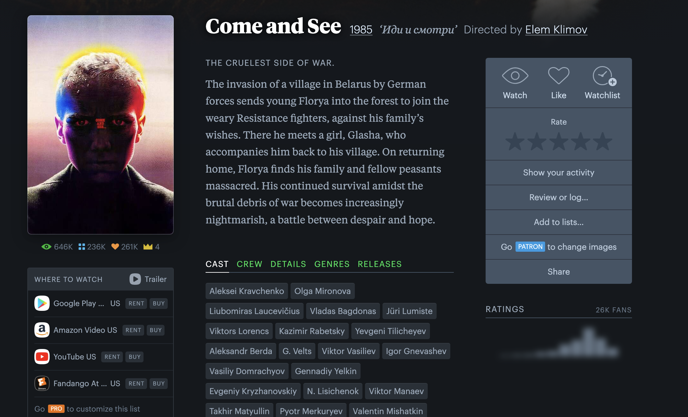
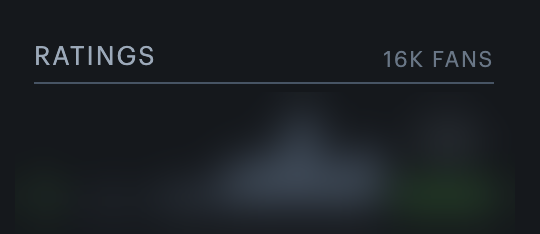
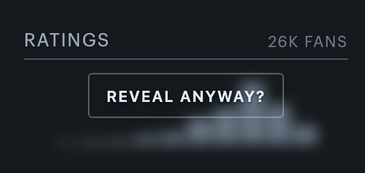
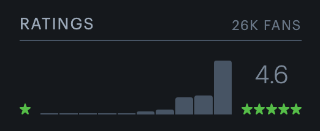
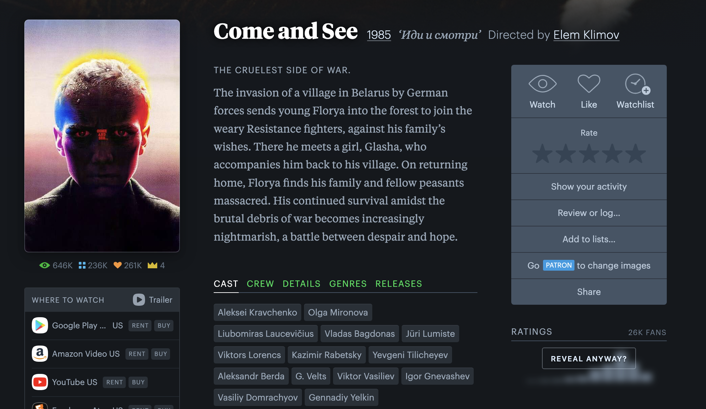
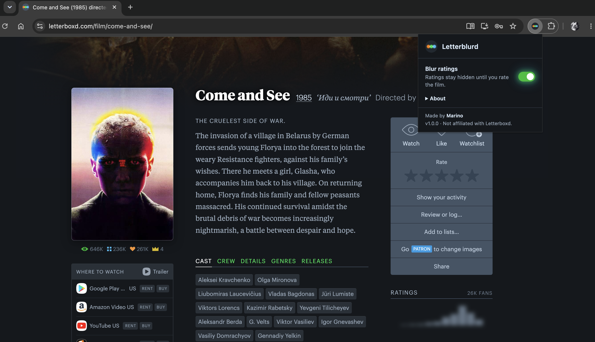

# Letterblurd

A browser extension that hides Letterboxd ratings until you've rated the film yourself. Form your own opinion. Remember those?

## How it works

On any `letterboxd.com/film/...` page, the ratings histogram and average are swapped for a blurred decoy. The decoy has the same shape on every film, so the blur can't give away the real distribution.

- **Rate the film** and the real chart fades in.
- **Hover the chart** and click **Reveal anyway?** if you can't wait.
- **Toggle it off** from the toolbar popup to see ratings everywhere.

| Hidden | Hover | Rated |
| --- | --- | --- |
|  |  |  |

## Install

1. Clone or download this repo.
2. Open `chrome://extensions` and turn on **Developer mode**.
3. Click **Load unpacked** and select the repo folder.

## Privacy

No tracking, no accounts. The only thing stored is the on/off switch, in your browser's sync storage.

## Troubleshooting

If Letterboxd changes its markup and something breaks, the selectors live at the top of [content.js](content.js). For logs, run `localStorage.setItem("letterblurd:debug", "1")` in the console on a film page and reload.

---

Made by [Marino](https://github.com/marinocom). Not affiliated with Letterboxd.
